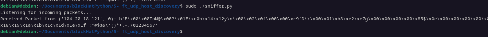
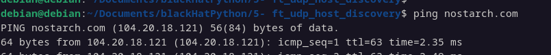

### 🔥 **What Does This Script Do?**
This script is a **simple network packet sniffer** that listens for incoming **ICMP (ping) packets** on your machine.  

💡 **How It Works:**  
1. **Creates a raw socket** → This allows direct access to network packets.  
2. **Binds the socket** to `127.0.0.1` (loopback address).  
3. **Captures packets** including their **IP headers**.  
4. **Listens for ICMP packets** (used by the `ping` command).  
5. **Prints the received packet** in raw bytes.  

---

### 🔧 **How to Test the Script**
#### **Step 1: Run the Script as Root**
Since raw sockets require **administrator privileges**, run the script as root:

🔹 **On Linux/macOS:**
```bash
sudo python3 script.py
```

🔹 **On Windows (Run as Administrator):**
```powershell
python script.py
```

The script will now **wait** for incoming ICMP (ping) packets.

---

#### **Step 2: Generate ICMP Traffic**
To see packets, you need to **send a ping** to your localhost.

🔹 **In another terminal, run:**
```bash
ping 127.0.0.1
```
This sends ICMP Echo Request packets, which your sniffer should capture.

---

#### **Step 3: Check the Output**
If the script is working, you should see something like this:
```
Listening for incoming packets...
Received Packet from ('127.0.0.1', 0): b'E\x00\x00T\xa7\xcc\x00\x00@\x01\xbe\xfc\x7f\x00\x00\x01\x7f\x00\x00\x01\x08\x00\x97S\x00\x01\x00\x01abcdefghijklmnopqrstuvwabcdefghi'
```
This is a **raw ICMP packet** (in bytes).  

---

### 🚀 **Next Steps**
If you want to **decode the packet**, you can:
- **Extract the IP header** 🏗️
- **Extract the ICMP payload** 🔎
- **Print packet details** 🖥️

Would you like me to modify the script to **parse the packets** and show readable output? 😊

If you want to **test the script on another host**, you need to:  
✅ Bind to **your network interface IP** instead of `127.0.0.1`.  
✅ Run the sniffer on **one machine** and send pings from **another machine**.

---

### **🔧 How to Modify the Script for Remote Testing**
#### 1️⃣ **Find Your Local IP Address**
On the **sniffer machine**, run:  

🔹 **Linux/macOS:**  
```bash
ip a | grep inet
```
🔹 **Windows (PowerShell):**  
```powershell
ipconfig
```
Look for an IP like `192.168.x.x` (private network).

---

#### 2️⃣ **Modify the Script to Bind to Your IP**
Change this line in the script:
```python
host = "127.0.0.1"
```
➡ **Replace it with your actual IP (e.g., `192.168.1.100`)**:
```python
host = "192.168.1.100"
```
Now, the sniffer will listen for packets **from any device** on the same network.

---

#### 3️⃣ **Run the Sniffer on Machine A**
On the **sniffer machine**, run:  
```bash
sudo python3 script.py
```
This will now listen for incoming ICMP packets **from other devices**.

---

#### 4️⃣ **Send a Ping from Machine B**
From another machine on the same network, run:  
```bash
ping 192.168.1.100
```
This will send ICMP packets **to the sniffer machine**.

---

#### 5️⃣ **Check the Sniffer Output**
If everything is correct, you should see:
```
Listening for incoming packets...
Received Packet from ('192.168.1.101', 0): b'E\x00\x00T\x9b\xcc\x00\x00@\x01\xae\xfc\xc0\xa8\x01\x65\xc0\xa8\x01\x66\x08\x00..."
```
This means the sniffer successfully captured a ping packet from **192.168.1.101** (the sender).

---

### **🌟 Extra: Listen on All Interfaces**
If you want the sniffer to capture packets from **any** network interface, bind to `"0.0.0.0"`:
```python
host = "0.0.0.0"
```
This will listen for ICMP packets on **all available network interfaces**.

Let me know if you need further modifications! 🚀

Demo test



